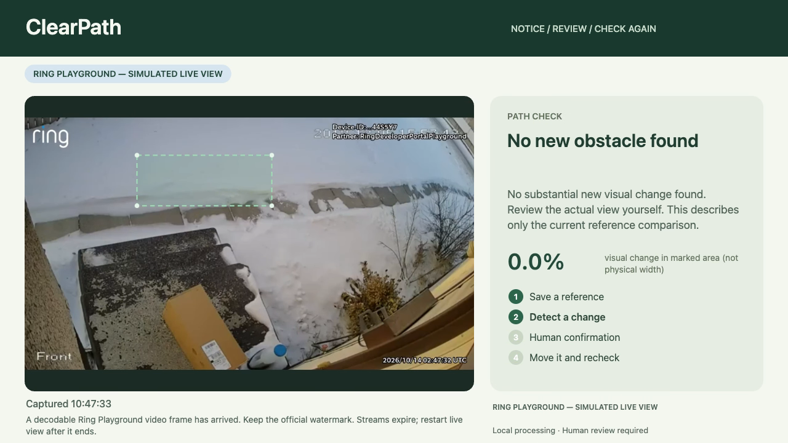

# Ring integration verification — 14 October 2026

Current source was exercised through the official Ring Developer Playground, local Python proxy, WebRTC/WHEP reception, decoded video, reference capture, local comparison, and disconnect. This is a simulator integration check, not a physical-camera accuracy test.

## Observed sequence

- The user’s existing developer session generated a new short-lived test token. It was passed only through the local password field into local server memory.
- The official device API returned one Playground device. Presentation privacy hid its display name.
- ClearPath negotiated the official WHEP stream and displayed a moving, watermarked Ring video. A decodable frame arrived at 10:47:10 Asia/Shanghai.
- The marked region was a visibly empty upper-step area. The package already present lower in the sample was excluded from this reference region.
- At 10:47:32, the application saved an empty-region reference from that received stream. At 10:47:33, local comparison returned `clear` with 0.0% significant change. This proves that the same real received input entered local comparison; it does not prove obstacle detection.
- The checks were exported with source `ring_playground`, evidence frames and capture times. Stream-expiry handling was also observed separately: the app invalidated the old result and required a restart.
- The local disconnect action removed the token and session handles. The short-lived token was not saved in source files or recordings.

The source video and full local runtime reports stay outside the public source release. The submission film contains an explicitly labeled excerpt of the recorded application output. It shows Ring simulation and self-recorded development material as separate sources.

## Footage attribution

Ring Playground sample: frollard, [Thief stealing our package](https://www.youtube.com/watch?v=TfTFu8lGrwk), used under [CC BY 4.0](https://creativecommons.org/licenses/by/4.0/). Ring cropped the original sample; ClearPath added its real interface, marked region and comparison result. The official watermark is retained.

[Ring Playground](https://developer.amazon.com/ring/console/playground) · [Ring API documentation](https://developer.amazon.com/docs/ring/api-documentation.html)
